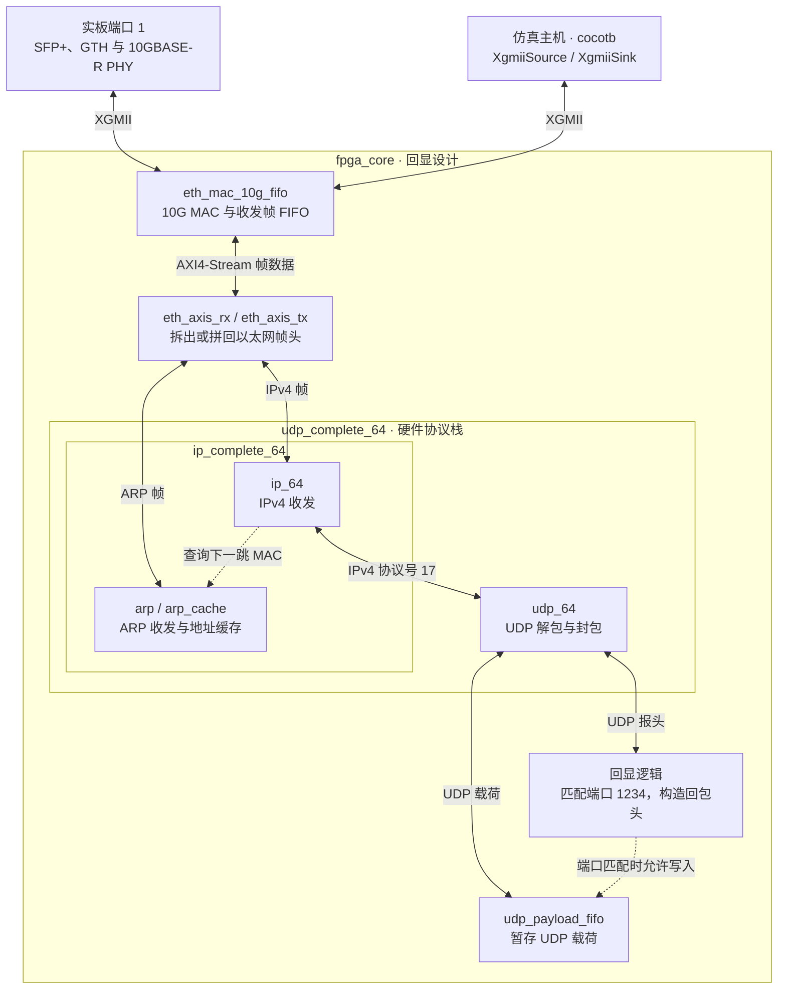

# ExaNIC X10 的 10G 以太网 UDP 回显

这是串口与 FIFO 之后的第二个项目。用一笔发往 UDP 端口 1234 的事务读懂已有 FPGA 工程，再把观察到的握手、ARP 解析和实际回包对应起来。适合 FPGA 网络接口、技术应用和模块集成验证。

## 工程框架

主机向 `192.168.1.128:1234` 发一个 UDP 包，FPGA 从同一个 10G 端口把载荷原样送回。收帧、解析协议和构造回包都由 FPGA 内并行工作的 Verilog 模块完成。**实板顶层是 `fpga`**，它把 SFP 端口、收发器和 `fpga_core` 接起来。**原始仿真的顶层是 `fpga_core`**，Python 测试扮演主机，直接驱动和观察 MAC 与 PHY 之间的 XGMII 接口。该接口收、发各有 64 位数据和 8 位控制信号。

双向实线表示收、发两条数据通路，虚线表示查询或控制。**读图时先跟一帧 UDP 向下走**，到达回显逻辑后分开看报头和载荷。**再跟回包向上走**，如果发送侧尚未缓存主机的 MAC，就沿 ARP 分支先发广播请求。收到主机的 ARP 应答后，FPGA 才能把 UDP 回包封成发往主机的以太网帧。

| 源码入口 | 打开后先看什么 |
| --- | --- |
| [板级顶层 fpga.v](verilog-ethernet/example/ExaNIC_X10/fpga/rtl/fpga.v) | 找 `sfp_phy_inst` 和 `core_inst`，用 `sfp_1_rxd_int` 追 PHY 到核心的接收方向，用 `sfp_1_txd_int` 追发送方向。板级接了两个 SFP 端口，回显只使用端口 1，端口 2 的发送端持续输出空闲控制字符。 |
| [eth_mac_10g_fifo.v](verilog-ethernet/rtl/eth_mac_10g_fifo.v) · [eth_axis_rx.v](verilog-ethernet/rtl/eth_axis_rx.v) · [eth_axis_tx.v](verilog-ethernet/rtl/eth_axis_tx.v) | MAC 在 XGMII 与 AXI4-Stream 之间收发整帧，收发 FIFO 连接端口时钟与业务时钟。随后 `eth_axis_rx` 拆出目的 MAC、源 MAC 和 EtherType，发送时 `eth_axis_tx` 将这些字段拼回帧头。 |
| [udp_complete_64.v](verilog-ethernet/rtl/udp_complete_64.v) · [ip_complete_64.v](verilog-ethernet/rtl/ip_complete_64.v) · [arp.v](verilog-ethernet/rtl/arp.v) | 先看 EtherType 如何把 IPv4（`0x0800`）和 ARP（`0x0806`）分开，再看 IPv4 的协议号 `17` 如何选中 UDP。发送方向上，IPv4 向 ARP 模块查询下一跳 MAC，ARP 帧和 IPv4 帧共用同一个 MAC 发出。 |
| [业务核心 fpga_core.v](verilog-ethernet/example/ExaNIC_X10/fpga/rtl/fpga_core.v) · [axis_fifo.v](verilog-ethernet/lib/axis/rtl/axis_fifo.v) | 搜 `match_cond` 找到端口过滤。匹配时，请求的源 IP 成为回包目的 IP，两个 UDP 端口互换。再搜 `udp_payload_fifo`，看载荷怎样经同一业务时钟下的 FIFO 送回发送侧。 |
| [测试平台 test_fpga_core.py](verilog-ethernet/example/ExaNIC_X10/fpga/tb/fpga_core/test_fpga_core.py) | pytest 收集 `test_fpga_core`，由它调用 cocotb-test 启动仿真器（默认 Icarus Verilog）。cocotb 的 `run_test` 用 Scapy 组包，经 `sfp_source[0]` 向端口 1 注入 UDP 请求和 ARP 应答，从 `sfp_sink[0]` 接收并检查 ARP 请求和 UDP 回包。 |

## 学习路线

截至 2026-11-26，Ubuntu 仿真已验证同一主机首次请求时的四帧交互，以及第二次请求时的两帧交互。**当前从第 3 阶段开始**，把一次完整的 UDP 回显放大到时钟周期，确认载荷的最后一拍究竟何时被接收。历次实验结果和学习问答集中在同一份[学习日志](log.md)。

| 阶段 | 要学会什么 | 怎样验收 | 进度 |
| --- | --- | --- | --- |
| 1 · 工程框架 | 从实板顶层 `fpga` 找到 PHY、MAC、协议栈和回显逻辑，指出仿真主机从哪里接入。 | 沿端口 1 画出一帧的往返路径，并在图上标出 `fpga_core` 的 XGMII 边界。[工程框架与源码入口](#工程框架) | 已走读，Vivado 已展开 RTL |
| 2 · 逐帧解释 UDP 回显 | 从主机和 FPGA 两侧解释每帧由谁发送、为什么需要它，以及 FPGA 如何得到回包目的 MAC。 | 对照同一次仿真的两轮流量，解释首轮的 UDP 请求 → ARP 请求 → ARP 应答 → UDP 回包，以及缓存命中后为何只剩 UDP 请求和回包。用第二包独有的 256 字节载荷核对回显。[实测记录](log.md) | 原始回显、ARP 缓存及连续两包实验均已通过 |
| **3 · 逐拍读 AXI4-Stream 与 FIFO** | 跟踪 `udp_payload_fifo` 输出，区分末拍出现、下游施加背压和末拍被接收这三个时刻。 | 在波形上圈出末拍停顿的周期，标出 `tvalid && tready && tlast` 同时为 1 的上升沿，解释这一拍为何只传一次。[载荷通路与握手观察点](udp-verification.md#用一笔事务读-rtl) | **已读连线，待波形验收** |
| 4 · 修改 RTL 并写自检用例 | 给端口 1 的 MAC 用户侧增加收、发帧计数器，各自在接受帧尾时加一。 | 在 cocotb 中断言每轮计数增量。首轮预期 RX、TX 各加 2，第二轮命中缓存时各加 1。可再用目的端口 1235 检查过滤，随后用 1234 检查仍能回显。[扩展实验](udp-verification.md#基线之后的两个小实验) | 计数器与扩展用例待实现 |
| 5 · 时钟、时序与上板 | 从端口 1 TX 时钟追到业务时钟，核对 MAC 收发 FIFO 两侧的时钟，并与单时钟的 `udp_payload_fifo` 对照。 | 综合、布局布线后，核查时钟约束、跨时钟域（CDC）报告及建立和保持余量。有 X10 板卡时，用主机抓包和 ILA 对照同一笔回显。[Vivado 信号与报告](vivado.md#下一步看哪些信号与报告) | 工程已重建，时序和板级收发待实测 |

**下一次 30 分钟实验**可以只看 FIFO 输出。打开 [FIFO 的 cocotb 测试](verilog-ethernet/lib/axis/tb/axis_fifo/test_axis_fifo.py)，选与 X10 载荷通路一致的 64 位、`FRAME_FIFO=0` 配置。用接收端的 `set_backpressure_generator` 让 `m_axis_tready` 在末拍到达前拉低，并在末拍出现后保持低电平至少两个周期。观察这段时间里 `m_axis_tvalid` 和 `m_axis_tlast` 持续为 1，`m_axis_tdata` 和 `m_axis_tkeep` 保持不变。把停顿和恢复接收的上升沿标在同一张波形上，记入[学习日志](log.md)。

上游源码在本目录的 `verilog-ethernet/`，固定于 `77320a9471d19c7dd383914bc049e02d9f4f1ffb`。工作目录中的 [create_project.tcl](create_project.tcl) 和 [inspect_design.tcl](inspect_design.tcl) 用于创建工程和导出报告。上游已将后续开发转至 Taxi，本项目复现沿用上述提交。[固定版本的 X10 示例](https://github.com/alexforencich/verilog-ethernet/tree/77320a9471d19c7dd383914bc049e02d9f4f1ffb/example/ExaNIC_X10/fpga)
