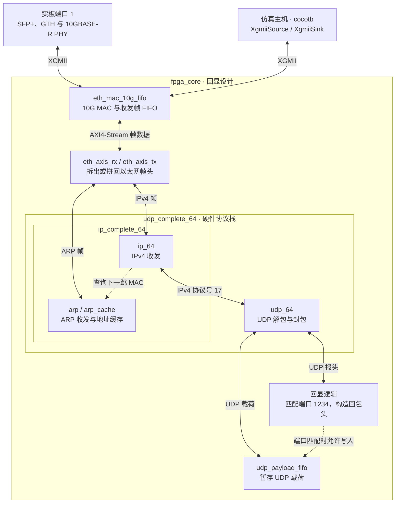

# ExaNIC X10 的 10G 以太网 UDP 回显

这是串口与 FIFO 之后的第二个项目。用一笔发往 UDP 端口 1234 的事务读懂已有 FPGA 工程，再把观察到的握手、ARP 解析和实际回包对应起来。适合 FPGA 网络接口、技术应用和模块集成验证。

## 工程框架

主机向 `192.168.1.128:1234` 发一个 UDP 包，FPGA 从同一个 10G 端口把载荷原样送回。收帧、解析协议和构造回包都由 FPGA 内并行工作的 Verilog 模块完成。**实板顶层是 `fpga`**，它把 SFP 端口、收发器和 `fpga_core` 接起来。**原始仿真的顶层是 `fpga_core`**，Python 测试扮演主机，直接驱动和观察 MAC 与 PHY 之间的 XGMII 接口。该接口收、发各有 64 位数据和 8 位控制信号。

双向实线表示收、发两条数据通路，虚线表示查询或控制。**读图时先跟一帧 UDP 向下走**，到达回显逻辑后分开看报头和载荷。**再跟回包向上走**，如果发送侧尚未缓存主机的 MAC，就沿 ARP 分支先发广播请求。收到主机的 ARP 应答后，FPGA 才能把 UDP 回包封成发往主机的以太网帧。

| 源码入口 | 打开后先看什么 |
| --- | --- |
| [板级顶层 fpga.v](verilog-ethernet/example/ExaNIC_X10/fpga/rtl/fpga.v) | 找 `sfp_phy_inst` 和 `core_inst`，用 `sfp_1_rxd_int` 追 PHY 到核心的接收方向，用 `sfp_1_txd_int` 追发送方向。板级接了两个 SFP 端口，回显只使用端口 1，端口 2 的发送端持续输出空闲控制字符。 |
| [eth_mac_10g_fifo.v](verilog-ethernet/rtl/eth_mac_10g_fifo.v) · [eth_axis_rx.v](verilog-ethernet/rtl/eth_axis_rx.v) · [eth_axis_tx.v](verilog-ethernet/rtl/eth_axis_tx.v) | MAC 在 XGMII 与 AXI4-Stream 之间收发整帧，收发 FIFO 连接端口时钟与业务时钟。随后 `eth_axis_rx` 拆出目的 MAC、源 MAC 和 EtherType，发送时 `eth_axis_tx` 将这些字段拼回帧头。 |
| [udp_complete_64.v](verilog-ethernet/rtl/udp_complete_64.v) · [ip_complete_64.v](verilog-ethernet/rtl/ip_complete_64.v) · [arp.v](verilog-ethernet/rtl/arp.v) | 先看 EtherType 如何把 IPv4（`0x0800`）和 ARP（`0x0806`）分开，再看 IPv4 的协议号 `17` 如何选中 UDP。发送方向上，IPv4 向 ARP 模块查询下一跳 MAC，ARP 帧和 IPv4 帧共用同一个 MAC 发出。 |
| [业务核心 fpga_core.v](verilog-ethernet/example/ExaNIC_X10/fpga/rtl/fpga_core.v) · [axis_fifo.v](verilog-ethernet/lib/axis/rtl/axis_fifo.v) | 搜 `match_cond` 找到端口过滤。匹配时，请求的源 IP 成为回包目的 IP，两个 UDP 端口互换。再搜 `udp_payload_fifo`，看载荷怎样经同一业务时钟下的 FIFO 送回发送侧。 |
| [测试平台 test_fpga_core.py](verilog-ethernet/example/ExaNIC_X10/fpga/tb/fpga_core/test_fpga_core.py) | pytest 收集 `test_fpga_core`，由它调用 cocotb-test 启动仿真器（默认 Icarus Verilog）。cocotb 的 `run_test` 用 Scapy 组包，经 `sfp_source[0]` 向端口 1 注入 UDP 请求和 ARP 应答，从 `sfp_sink[0]` 接收并检查 ARP 请求和 UDP 回包。 |

## 学习路线

每次实验的计划、学习问答和实测结果都记在同一份[学习日志](log.md)中，最近一次在页首。

| 顺序 | 做什么 | 验收 |
| --- | --- | --- |
| 1 | 在 Windows 打开或重建 Vivado 工程，从顶层 `fpga` 找到业务核心 `fpga_core`、收发器、时钟和复位。 | 可指认源文件、器件、IP 和实际时钟连接。见 [Vivado 重建与实测记录](vivado.md)。 |
| 2 | 读一遍预期的 UDP → ARP → UDP 事务，在 Ubuntu 的同一上游提交上运行原始 pytest。 | 保存退出状态、实际断言和日志，再写下本次仿真覆盖的接口。见 [数据通路与 cocotb 验证](udp-verification.md)。 |
| 3 | 增加一个被过滤的端口用例，或用已知报文检查 MAC 帧计数。准备上板时再跑综合、布局布线和板级流量。 | 自动判断新增用例，解释第一次偏离的信号。板测另存时序报告、ILA 与实收发记录。 |

**进度。** 2026-11-11，Windows 上通过 Vivado MCP 创建并展开 RTL。11-19，Ubuntu 上的 XSim 最小仿真通过。11-20，用 Vivado 重新打开迁移后的工程，已逐一核对设计输入。X10 原始 `run_test`、实现时序及 SFP 板级收发仍待实测。

上游源码在本目录的 `verilog-ethernet/`，固定于 `77320a9471d19c7dd383914bc049e02d9f4f1ffb`。工作目录中的 [create_project.tcl](create_project.tcl) 和 [inspect_design.tcl](inspect_design.tcl) 用于创建工程和导出报告。上游已将后续开发转至 Taxi，本项目复现沿用上述提交。[固定版本的 X10 示例](https://github.com/alexforencich/verilog-ethernet/tree/77320a9471d19c7dd383914bc049e02d9f4f1ffb/example/ExaNIC_X10/fpga)
